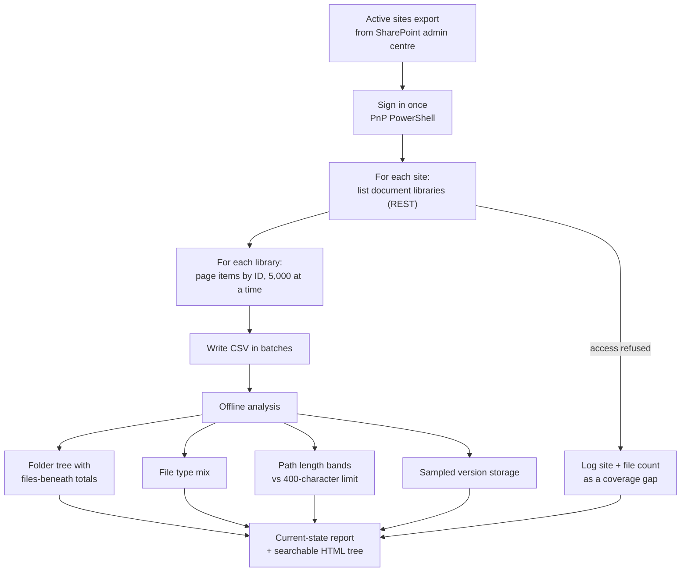
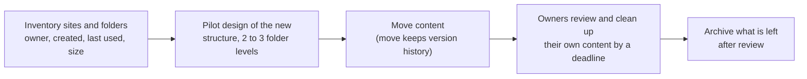
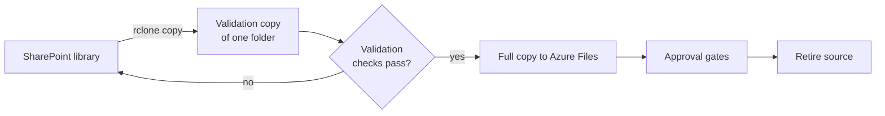

# SharePoint Tenant Audit and Migration

A read-only method for auditing a SharePoint Online tenant before a restructure or migration: every site, library, folder and file is extracted once, then analysed offline so the folder tree, file mix, path lengths and storage can be re-cut without touching the tenant again. I have used it for current-state reports ahead of information architecture redesigns, a SharePoint to Azure Files migration and a legacy Office file conversion.

> Case study. Scripts, reports and tenant data are not published. This repository documents the method and the lessons. All names and values shown are generic.

## Method

About 1,500 rows a second; roughly 880,000 items in about ten minutes.

## Why ID paging and not the obvious options

| Tried | Result |
|---|---|
| OData next-link paging | Silently stopped after one page on every library |
| Filtering on folder vs file | Not indexed, refused on any library over 5,000 items |
| Search API | About 10,000 rows per query, security trimmed, totals unreliable |
| Graph site search | Rejected or failed to resolve many sites |
| One call per folder | Does not scale past a few levels |
| **Page by ID, skip folders in code** | **Deterministic, fast, no threshold errors** |

## Restructure approach

## Azure Files migration

## Legacy Office files

Old .doc and .xls files were being blocked by current Office policy. The audit found them by extension and by reading the Word file header, converted them to current formats, and checked each Excel conversion by comparing populated cell and formula counts rather than the used range, which old files overstate.

## Reporting rules I follow

- Coverage statement first: how much of the tenant the figures cover and what was refused.
- Label items and files separately (library item counts include folders).
- Source and date for every figure; reconcile totals from different sources.
- Measured facts only. If the reason something exists is not established, say so and name who would know.

## Stack

PnP PowerShell, SharePoint REST API, offline analysis scripts, rclone, Azure Files, Excel and Word reports.
